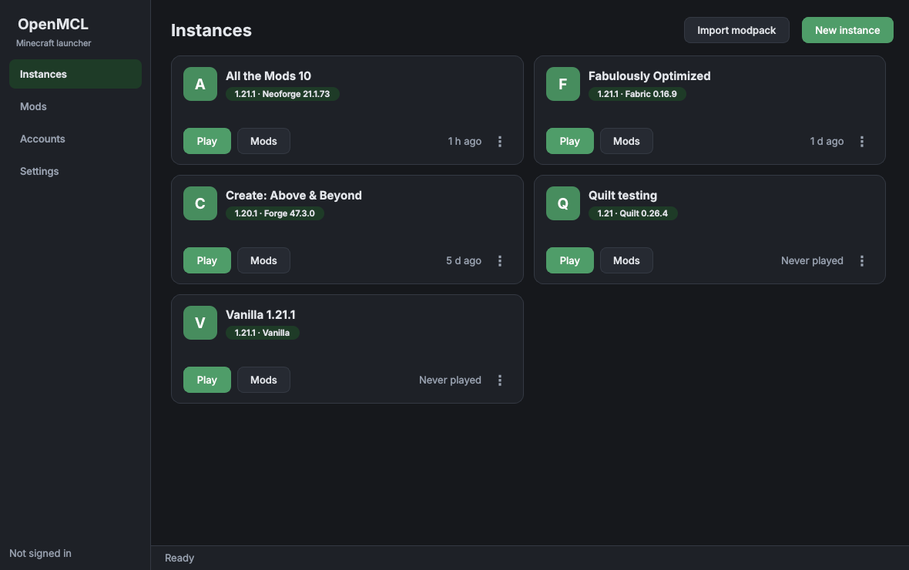

<div align="center">

# OpenMCL

**Keep every Minecraft pack in its own box.**

Each setup gets its own worlds, mods and Java, so updating one never breaks
another. Four mod loaders, installed for you. Modrinth and CurseForge in one
search.

[**Download**](https://github.com/silocell/OpenMCL-Launcher/releases/latest) ·
[Website](https://silocell.github.io/OpenMCL-Launcher/) ·
[Report a problem](https://github.com/silocell/OpenMCL-Launcher/issues)

[](https://github.com/silocell/OpenMCL-Launcher/actions/workflows/build.yml)
[](LICENSE)



</div>

## Download

No Python, no setup — each build is self-contained.

| Platform | File | Notes |
| --- | --- | --- |
| Windows 10+ (64-bit) | [OpenMCL.exe](https://github.com/silocell/OpenMCL-Launcher/releases/latest/download/OpenMCL.exe) | SmartScreen will warn; see below |
| macOS 11+ | [OpenMCL.app](https://github.com/silocell/OpenMCL-Launcher/releases/latest/download/OpenMCL-macos.zip) | Right-click → Open on first run |
| Linux (glibc 2.35+) | [OpenMCL](https://github.com/silocell/OpenMCL-Launcher/releases/latest/download/OpenMCL) | `chmod +x OpenMCL` first |

You need a Microsoft account that owns **Minecraft: Java Edition**. OpenMCL
checks that it does and won't launch otherwise. There is no offline or cracked
mode, and there won't be one.

### First run

**Windows** shows “Windows protected your PC”, because the build isn't
code-signed. Choose *More info* → *Run anyway*.

**macOS** blocks it for the same reason. Right-click the app → *Open* → *Open*.

The single-file builds unpack themselves on each launch, so the first window
takes five to ten seconds to appear. That's normal.

## Set up sign-in

This is the one fiddly part, and it is Mojang's rule rather than a choice:
**Minecraft only accepts sign-ins from registered applications**, so no
third-party launcher can ship with a sign-in key of its own. You register a
free Microsoft application once and paste its ID into Settings.

1. Go to the [Azure portal](https://portal.azure.com/) and sign in with any
   Microsoft account.
2. **Microsoft Entra ID → App registrations → New registration**.
3. Name it anything. Under *Supported account types* choose one that includes
   **personal Microsoft accounts**. Leave **Redirect URI empty** — the
   device-code flow doesn't use one.
4. Click **Register**, then copy the **Application (client) ID** from the
   Overview page. It looks like `3f8a1b2c-4d5e-6f70-8a9b-0c1d2e3f4a5b`.
5. Open **Authentication**, scroll to *Advanced settings*, set **Allow public
   client flows** to **Yes**, and **Save**. Without this, sign-in is rejected.
6. In OpenMCL: **Settings → Microsoft client ID**, paste, **Save**.

Then **Accounts → Add account**. OpenMCL shows a short code; approve it at
`microsoft.com/link` with the account that owns the game. Your password is
never typed into the launcher.

> **If sign-in returns a 403**, your new application hasn't been approved for
> the Minecraft API yet. Apply at <https://aka.ms/mce-reviewappid>. Newly
> registered applications need this before Minecraft will accept them.

### CurseForge (optional)

Modrinth works immediately. To browse CurseForge as well, get a free key from
the [CurseForge console](https://console.curseforge.com/) and paste it into
**Settings → CurseForge key**. Using it means accepting CurseForge's
[third-party API terms](https://support.curseforge.com/en/support/solutions/articles/9000207405).

Some CurseForge projects block third-party downloads entirely. No launcher can
fetch those; OpenMCL names them and links you to the page so you can download
the jar yourself and drop it in the instance's mods folder.

## What it does

**Instances stay separate.** Each one is a complete `.minecraft` with its own
worlds, mods, configs, Java path, memory and window settings. Duplicate,
export or delete one without touching the others. Versions, libraries and
assets are shared behind the scenes, so a second instance on the same version
downloads nothing.

**Four loaders, installed for you.** Fabric and Quilt come from their own
metadata APIs. NeoForge and Forge download the official installer and run its
patching step locally — the same work the official installer does.

**Mods from both places at once.** Search Modrinth and CurseForge side by
side, filtered to the version and loader you're actually running. Required
dependencies install alongside. *Check for updates* compares every tracked mod
against its newest build. Jars you drop in by hand appear in the list too, and
can be enabled, disabled or removed like any other.

**Modpacks in and out.** Import `.mrpack` and CurseForge `.zip` packs — the
instance, loader, files and overrides are all set up for you. Export any
instance back out as a `.mrpack` to share it.

**Make it yours.** Three themes, any accent colour, adjustable text size, and
per-instance overrides for Java, memory, JVM arguments and window size.

## Where your files live

| | |
| --- | --- |
| Windows | `%APPDATA%\OpenMCL` |
| macOS | `~/Library/Application Support/OpenMCL` |
| Linux | `~/.local/share/openmcl` |

Worlds and mods sit under `instances/<name>/minecraft/`. Game versions,
libraries and assets are shared in `shared/`. Set the `OPENMCL_HOME`
environment variable to put everything somewhere else — useful for a portable
install on a USB stick.

## Known limits

- It's version 0.1.0. Expect rough edges, and please
  [report them](https://github.com/silocell/OpenMCL-Launcher/issues).
- Builds are unsigned, so Windows and macOS both warn on first run.
- Forge below 1.13 uses the old installer format. It's handled, but far less
  tested than modern versions.
- Installing Forge or NeoForge runs a local patching step that can take a
  minute or two the first time. Reinstalling skips work already done.
- CurseForge search stops at 10,000 results, which is their API limit.

## Running from source

Needs Python 3.10+ and a Java runtime. OpenMCL finds installed Java itself
(`JAVA_HOME`, `PATH`, the usual install directories, and runtimes the official
launcher installed) and picks the version each Minecraft release asks for.

```bash
git clone https://github.com/silocell/OpenMCL-Launcher
cd OpenMCL-Launcher
pip install -r requirements.txt
python run.py
```

Building your own executable is covered in
[`packaging/README.md`](packaging/README.md) — one script per platform, plus a
GitHub Actions workflow that builds all three.

Any build can be checked without signing in:

```bash
OpenMCL --version
OpenMCL --selftest    # builds every page, verifies bundled assets, exits
```

## Contributing

Issues and pull requests are welcome. Run the tests before opening one:

```bash
pip install pytest
QT_QPA_PLATFORM=offscreen python -m pytest tests/ -q
```

They cover the parts that fail silently when wrong: maven coordinate mapping,
rule evaluation, launch-argument substitution, loader profile inheritance,
classpath ordering, archive path-traversal refusal, and the Modrinth and
CurseForge response mappings. CI runs them on every push and won't build a
release if they fail.

If you fork this and distribute it, **register your own Microsoft application
ID** rather than reusing another project's. Sharing one attributes every
user's sign-in to that project's registration.

## Licence

Free software under the [GNU GPL v3](LICENSE). Built with
[Qt for Python](https://doc.qt.io/qtforpython/) under the LGPL v3.

Not affiliated with, endorsed by or connected to Mojang, Microsoft, Modrinth or
CurseForge. Minecraft is a trademark of Mojang Synergies AB. Game files are
downloaded from Mojang's own servers and a legitimate account that owns the
game is required.
